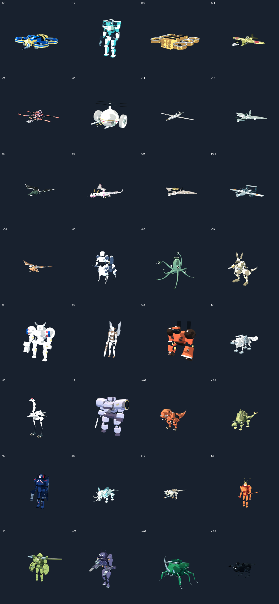
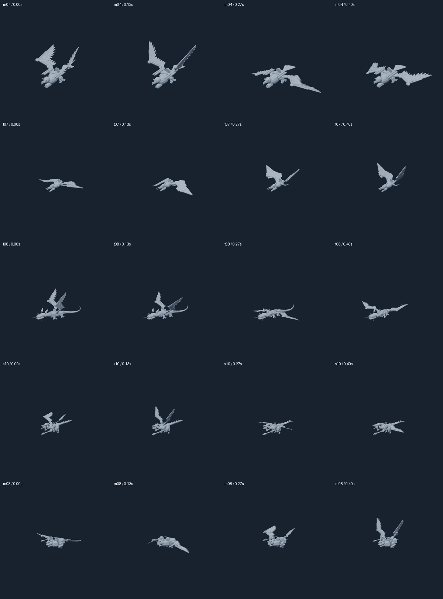

# Limb structure, weapon grips and flight motion

All 32 actors and 40 ground/flight forms retain exposed proximal joints. Dedicated shoulder and pelvic
socket geometry shows the attachment structure while keeping the axial body sealed.

Held weapons have full-length grips, four curled fingers and an opposed thumb mirrored for each hand.
Grasp origins remain fixed to wrist contacts through aiming, recoil, stowing and weapon scaling.

Feathered and membrane wings move through coupled humerus, ulna and manus joints. Elbow recovery precedes
wrist folding; membrane wings use smaller folding excursions. The curves are stylized species-informed motion.

The canonical sources are [the base contract](../../tools/mech_authoring/assets.json),
[morph contract](../../tools/mech_authoring/morphers.json), [builder](../../tools/mech_authoring/build.py),
[geometry recipe](../../tools/mech_authoring/catalog.py), [morph recipe](../../tools/mech_authoring/morph_recipe.py)
and [runtime wing driver](../../public/js/locomotion.js). Generated runtime meshes and exports share these owners.
Body motion is baked in the reference sources; combat files own the attached effect authoring tracks.
[The owl flight review scene](m08-flight-review.blend) opens the baked flight track with neutral viewport shading.

[Exact artifact hashes and gate results](delivery-validation.json) bind the inspected images to the final
editable scenes, exports and runtime assets. [Visual inspection](visual-review.json) is separate from human acceptance.

[Pterosaur](t07-flight.gif) · [Dragon](t08-flight.gif) · [Eagle](m04-flight.gif) ·
[Raptor/archaeopteryx](s10-flight.gif) · [Owl](m08-flight.gif) · [Grasp details](grips.png)

| Actor | Editable motion source | Interchange export | Combat effect source |
|---|---|---|---|
| s01 | [Blend](../../out/mech_reference/s01/s01.blend) | [GLB](../../public/assets/models/reference/s01.glb) | [Combat Blend](../../out/combat_reference/s01/s01.blend) |
| t10 | [Blend](../../out/mech_reference/t10/t10.blend) | [GLB](../../public/assets/models/reference/t10.glb) | [Combat Blend](../../out/combat_reference/t10/t10.blend) |
| s02 | [Blend](../../out/mech_reference/s02/s02.blend) | [GLB](../../public/assets/models/reference/s02.glb) | [Combat Blend](../../out/combat_reference/s02/s02.blend) |
| s04 | [Blend](../../out/mech_reference/s04/s04.blend) | [GLB](../../public/assets/models/reference/s04.glb) | [Combat Blend](../../out/combat_reference/s04/s04.blend) |
| s05 | [Blend](../../out/mech_reference/s05/s05.blend) | [GLB](../../public/assets/models/reference/s05.glb) | [Combat Blend](../../out/combat_reference/s05/s05.blend) |
| s08 | [Blend](../../out/mech_reference/s08/s08.blend) | [GLB](../../public/assets/models/reference/s08.glb) | [Combat Blend](../../out/combat_reference/s08/s08.blend) |
| s11 | [Blend](../../out/mech_reference/s11/s11.blend) | [GLB](../../public/assets/models/reference/s11.glb) | [Combat Blend](../../out/combat_reference/s11/s11.blend) |
| s12 | [Blend](../../out/mech_reference/s12/s12.blend) | [GLB](../../public/assets/models/reference/s12.glb) | [Combat Blend](../../out/combat_reference/s12/s12.blend) |
| t07 | [Blend](../../out/mech_reference/t07/t07.blend) | [GLB](../../public/assets/models/reference/t07.glb) | [Combat Blend](../../out/combat_reference/t07/t07.blend) |
| t08 | [Blend](../../out/mech_reference/t08/t08.blend) | [GLB](../../public/assets/models/reference/t08.glb) | [Combat Blend](../../out/combat_reference/t08/t08.blend) |
| t09 | [Blend](../../out/mech_reference/t09/t09.blend) | [GLB](../../public/assets/models/reference/t09.glb) | [Combat Blend](../../out/combat_reference/t09/t09.blend) |
| m03 | [Blend](../../out/mech_reference/m03/m03.blend) | [GLB](../../public/assets/models/reference/m03.glb) | [Combat Blend](../../out/combat_reference/m03/m03.blend) |
| m04 | [Blend](../../out/mech_reference/m04/m04.blend) | [GLB](../../public/assets/models/reference/m04.glb) | [Combat Blend](../../out/combat_reference/m04/m04.blend) |
| s06 | [Blend](../../out/mech_reference/s06/s06.blend) | [GLB](../../public/assets/models/reference/s06.glb) | [Combat Blend](../../out/combat_reference/s06/s06.blend) |
| s07 | [Blend](../../out/mech_reference/s07/s07.blend) | [GLB](../../public/assets/models/reference/s07.glb) | [Combat Blend](../../out/combat_reference/s07/s07.blend) |
| s09 | [Blend](../../out/mech_reference/s09/s09.blend) | [GLB](../../public/assets/models/reference/s09.glb) | [Combat Blend](../../out/combat_reference/s09/s09.blend) |
| t01 | [Blend](../../out/mech_reference/t01/t01.blend) | [GLB](../../public/assets/models/reference/t01.glb) | [Combat Blend](../../out/combat_reference/t01/t01.blend) |
| t02 | [Blend](../../out/mech_reference/t02/t02.blend) | [GLB](../../public/assets/models/reference/t02.glb) | [Combat Blend](../../out/combat_reference/t02/t02.blend) |
| t03 | [Blend](../../out/mech_reference/t03/t03.blend) | [GLB](../../public/assets/models/reference/t03.glb) | [Combat Blend](../../out/combat_reference/t03/t03.blend) |
| t04 | [Blend](../../out/mech_reference/t04/t04.blend) | [GLB](../../public/assets/models/reference/t04.glb) | [Combat Blend](../../out/combat_reference/t04/t04.blend) |
| t05 | [Blend](../../out/mech_reference/t05/t05.blend) | [GLB](../../public/assets/models/reference/t05.glb) | [Combat Blend](../../out/combat_reference/t05/t05.blend) |
| t12 | [Blend](../../out/mech_reference/t12/t12.blend) | [GLB](../../public/assets/models/reference/t12.glb) | [Combat Blend](../../out/combat_reference/t12/t12.blend) |
| m02 | [Blend](../../out/mech_reference/m02/m02.blend) | [GLB](../../public/assets/models/reference/m02.glb) | [Combat Blend](../../out/combat_reference/m02/m02.blend) |
| m06 | [Blend](../../out/mech_reference/m06/m06.blend) | [GLB](../../public/assets/models/reference/m06.glb) | [Combat Blend](../../out/combat_reference/m06/m06.blend) |
| m01 | [Blend](../../out/morph_reference/m01/m01.blend) | [GLB](../../public/assets/models/reference/m01.glb) | [Combat Blend](../../out/combat_reference/m01/m01.blend) |
| s03 | [Blend](../../out/morph_reference/s03/s03.blend) | [GLB](../../public/assets/models/reference/s03.glb) | [Combat Blend](../../out/combat_reference/s03/s03.blend) |
| s10 | [Blend](../../out/morph_reference/s10/s10.blend) | [GLB](../../public/assets/models/reference/s10.glb) | [Combat Blend](../../out/combat_reference/s10/s10.blend) |
| t06 | [Blend](../../out/morph_reference/t06/t06.blend) | [GLB](../../public/assets/models/reference/t06.glb) | [Combat Blend](../../out/combat_reference/t06/t06.blend) |
| t11 | [Blend](../../out/morph_reference/t11/t11.blend) | [GLB](../../public/assets/models/reference/t11.glb) | [Combat Blend](../../out/combat_reference/t11/t11.blend) |
| m05 | [Blend](../../out/morph_reference/m05/m05.blend) | [GLB](../../public/assets/models/reference/m05.glb) | [Combat Blend](../../out/combat_reference/m05/m05.blend) |
| m07 | [Blend](../../out/morph_reference/m07/m07.blend) | [GLB](../../public/assets/models/reference/m07.glb) | [Combat Blend](../../out/combat_reference/m07/m07.blend) |
| m08 | [Blend](../../out/morph_reference/m08/m08.blend) | [GLB](../../public/assets/models/reference/m08.glb) | [Combat Blend](../../out/combat_reference/m08/m08.blend) |
