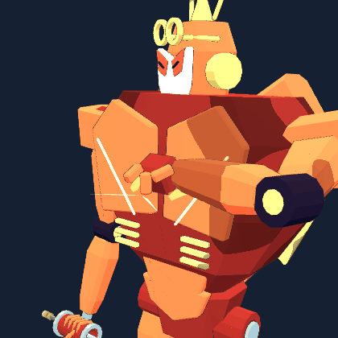

# Weapon structures and presentation

Accepted shot events advance one physical emitter per slot. Frame updates, morphing and cockpit scope changes preserve the order. Damage, fire rates, ammunition and hit rules remain unchanged.

| Actor | Authored behavior |
| --- | --- |
| t08 Dragon | Axial hardware follows the body; paired optical eyes alternate beam emission. |
| m04 Falcon | Four dorsal feather missiles eject in sequence along the existing penetration path. |
| s03 Leviathan | The terminal trunk/horn aims its beam; intertusk induction precedes the EMP pulse. |
| t06 Wukong | A free hand plucks a tuft, then repeatedly flicks its articulated fingers. |
| m05 Wolf | Running yields the predatory brace to the existing primate support swing. |
| m08 Panther/owl | Paired ventral light barrels and paired heavy suppressors alternate. |

Blender body scenes retain editable rigid controls and recovered actions. Combat scenes own authored effects. Runtime pose samples and independent GLB playback agree.

[Validation manifest](delivery-validation.json) · [Native gesture preview](t06-gesture-review.blend)

| Actor | Body owner | Interchange | Effect owner |
| --- | --- | --- | --- |
| s01 | [Body](../../out/mech_reference/s01/s01.blend) | [GLB](../../public/assets/models/reference/s01.glb) | [Effects](../../out/combat_reference/s01/s01.blend) |
| t10 | [Body](../../out/mech_reference/t10/t10.blend) | [GLB](../../public/assets/models/reference/t10.glb) | [Effects](../../out/combat_reference/t10/t10.blend) |
| s02 | [Body](../../out/mech_reference/s02/s02.blend) | [GLB](../../public/assets/models/reference/s02.glb) | [Effects](../../out/combat_reference/s02/s02.blend) |
| s04 | [Body](../../out/mech_reference/s04/s04.blend) | [GLB](../../public/assets/models/reference/s04.glb) | [Effects](../../out/combat_reference/s04/s04.blend) |
| s05 | [Body](../../out/mech_reference/s05/s05.blend) | [GLB](../../public/assets/models/reference/s05.glb) | [Effects](../../out/combat_reference/s05/s05.blend) |
| s08 | [Body](../../out/mech_reference/s08/s08.blend) | [GLB](../../public/assets/models/reference/s08.glb) | [Effects](../../out/combat_reference/s08/s08.blend) |
| s11 | [Body](../../out/mech_reference/s11/s11.blend) | [GLB](../../public/assets/models/reference/s11.glb) | [Effects](../../out/combat_reference/s11/s11.blend) |
| s12 | [Body](../../out/mech_reference/s12/s12.blend) | [GLB](../../public/assets/models/reference/s12.glb) | [Effects](../../out/combat_reference/s12/s12.blend) |
| t07 | [Body](../../out/mech_reference/t07/t07.blend) | [GLB](../../public/assets/models/reference/t07.glb) | [Effects](../../out/combat_reference/t07/t07.blend) |
| t08 | [Body](../../out/mech_reference/t08/t08.blend) | [GLB](../../public/assets/models/reference/t08.glb) | [Effects](../../out/combat_reference/t08/t08.blend) |
| t09 | [Body](../../out/mech_reference/t09/t09.blend) | [GLB](../../public/assets/models/reference/t09.glb) | [Effects](../../out/combat_reference/t09/t09.blend) |
| m03 | [Body](../../out/mech_reference/m03/m03.blend) | [GLB](../../public/assets/models/reference/m03.glb) | [Effects](../../out/combat_reference/m03/m03.blend) |
| m04 | [Body](../../out/mech_reference/m04/m04.blend) | [GLB](../../public/assets/models/reference/m04.glb) | [Effects](../../out/combat_reference/m04/m04.blend) |
| s06 | [Body](../../out/mech_reference/s06/s06.blend) | [GLB](../../public/assets/models/reference/s06.glb) | [Effects](../../out/combat_reference/s06/s06.blend) |
| s07 | [Body](../../out/mech_reference/s07/s07.blend) | [GLB](../../public/assets/models/reference/s07.glb) | [Effects](../../out/combat_reference/s07/s07.blend) |
| s09 | [Body](../../out/mech_reference/s09/s09.blend) | [GLB](../../public/assets/models/reference/s09.glb) | [Effects](../../out/combat_reference/s09/s09.blend) |
| t01 | [Body](../../out/mech_reference/t01/t01.blend) | [GLB](../../public/assets/models/reference/t01.glb) | [Effects](../../out/combat_reference/t01/t01.blend) |
| t02 | [Body](../../out/mech_reference/t02/t02.blend) | [GLB](../../public/assets/models/reference/t02.glb) | [Effects](../../out/combat_reference/t02/t02.blend) |
| t03 | [Body](../../out/mech_reference/t03/t03.blend) | [GLB](../../public/assets/models/reference/t03.glb) | [Effects](../../out/combat_reference/t03/t03.blend) |
| t04 | [Body](../../out/mech_reference/t04/t04.blend) | [GLB](../../public/assets/models/reference/t04.glb) | [Effects](../../out/combat_reference/t04/t04.blend) |
| t05 | [Body](../../out/mech_reference/t05/t05.blend) | [GLB](../../public/assets/models/reference/t05.glb) | [Effects](../../out/combat_reference/t05/t05.blend) |
| t12 | [Body](../../out/mech_reference/t12/t12.blend) | [GLB](../../public/assets/models/reference/t12.glb) | [Effects](../../out/combat_reference/t12/t12.blend) |
| m02 | [Body](../../out/mech_reference/m02/m02.blend) | [GLB](../../public/assets/models/reference/m02.glb) | [Effects](../../out/combat_reference/m02/m02.blend) |
| m06 | [Body](../../out/mech_reference/m06/m06.blend) | [GLB](../../public/assets/models/reference/m06.glb) | [Effects](../../out/combat_reference/m06/m06.blend) |
| m01 | [Body](../../out/morph_reference/m01/m01.blend) | [GLB](../../public/assets/models/reference/m01.glb) | [Effects](../../out/combat_reference/m01/m01.blend) |
| s03 | [Body](../../out/morph_reference/s03/s03.blend) | [GLB](../../public/assets/models/reference/s03.glb) | [Effects](../../out/combat_reference/s03/s03.blend) |
| s10 | [Body](../../out/morph_reference/s10/s10.blend) | [GLB](../../public/assets/models/reference/s10.glb) | [Effects](../../out/combat_reference/s10/s10.blend) |
| t06 | [Body](../../out/morph_reference/t06/t06.blend) | [GLB](../../public/assets/models/reference/t06.glb) | [Effects](../../out/combat_reference/t06/t06.blend) |
| t11 | [Body](../../out/morph_reference/t11/t11.blend) | [GLB](../../public/assets/models/reference/t11.glb) | [Effects](../../out/combat_reference/t11/t11.blend) |
| m05 | [Body](../../out/morph_reference/m05/m05.blend) | [GLB](../../public/assets/models/reference/m05.glb) | [Effects](../../out/combat_reference/m05/m05.blend) |
| m07 | [Body](../../out/morph_reference/m07/m07.blend) | [GLB](../../public/assets/models/reference/m07.glb) | [Effects](../../out/combat_reference/m07/m07.blend) |
| m08 | [Body](../../out/morph_reference/m08/m08.blend) | [GLB](../../public/assets/models/reference/m08.glb) | [Effects](../../out/combat_reference/m08/m08.blend) |
